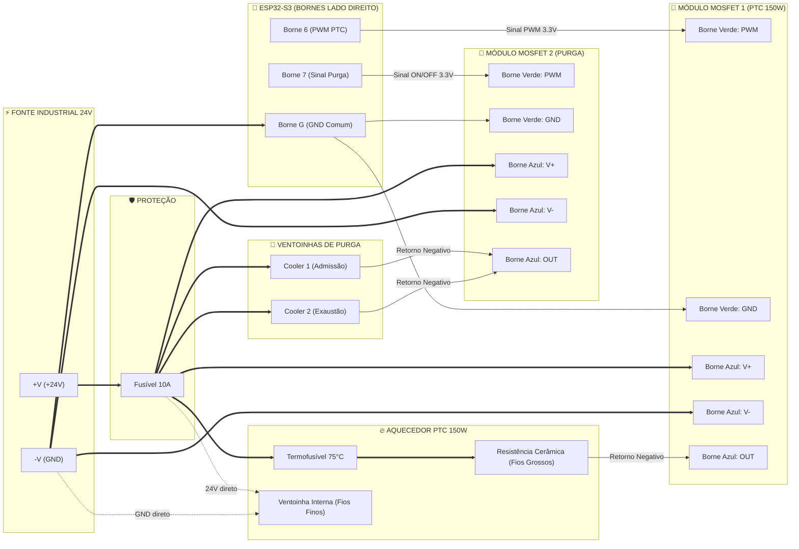

# Manual Técnico de Construção: Caixa Secadora Inteligente de Filamentos (60 Litros)

Este documento contém a especificação técnica completa, os fundamentos termodinâmicos, os esquemas elétricos, o guia mecânico passo a passo e o roteiro de comissionamento para a montagem de uma estufa secadora de filamentos 3D de alta capacidade (60L) baseada em microcontrolador **ESP32-S3 (WROOM-1 N16R8)**.

---

## Sumário
1. [Princípios de Engenharia & Termodinâmica da Secagem](#1-princípios-de-engenharia--termodinâmica-da-secagem)
   - [A Armadilha da Umidade Relativa (%UR)](#a-armadilha-da-umidade-relativa-ur)
   - [Equação de Magnus-Tetens e Umidade Absoluta](#equação-de-magnus-tetens-e-umidade-absoluta)
   - [Lógica de Purga Inteligente por Rajadas](#lógica-de-purga-inteligente-por-rajadas)
   - [Por que 50°C em Caixa de Isopor (EPS) Laminada?](#por-que-50c-em-caixa-de-isopor-eps-laminada)
   - [O Perigo da Reabsorção de Umidade Pós-Ciclo](#o-perigo-da-reabsorção-de-umidade-pós-ciclo)
2. [Lista de Materiais (BOM) e Termos de Busca](#2-lista-de-materiais-bom-e-termos-de-busca)
3. [Arquitetura Elétrica e Segurança Crítica](#3-arquitetura-elétrica-e-segurança-crítica)
   - [Medidas de Segurança Obrigatórias](#medidas-de-segurança-obrigatórias)
   - [Mapeamento de Pinos do ESP32](#mapeamento-de-pinos-do-esp32)
   - [Diagrama Esquemático em Blocos](#diagrama-esquemático-em-blocos)
4. [Construção Mecânica Passo a Passo](#4-construção-mecânica-passo-a-passo)
   - [Etapa 1: Furação e Corte no Isopor](#etapa-1-furação-e-corte-no-isopor)
   - [Etapa 2: Montagem do Bloco PTC e Proteção Térmica](#etapa-2-montagem-do-bloco-ptc-e-proteção-térmica)
   - [Etapa 3: Instalação das Ventoinhas de Purga (Montagem Sanduíche)](#etapa-3-instalação-das-ventoinhas-de-purga-montagem-sanduíche)
   - [Etapa 4: Eixo Central Suspenso para Carretéis](#etapa-4-eixo-central-suspenso-para-carretéis)
   - [Etapa 5: Posicionamento dos Sensores SHT31](#etapa-5-posicionamento-dos-sensores-sht31)
   - [Etapa 6: Caixa da Eletrônica Externa](#etapa-6-caixa-da-eletrônica-externa)
5. [Guia de Firmware e Upload](#5-guia-de-firmware-e-upload)
   - [Opção A: Upload via Arduino IDE](#opção-a-upload-via-arduino-ide)
   - [Opção B: Upload via PlatformIO (VS Code)](#opção-b-upload-via-platformio-vs-code)
6. [Interface Web & Integrações](#6-interface-web--integrações)
   - [Operação da Interface Web](#operação-da-interface-web)
   - [Telemetria MQTT (Home Assistant)](#telemetria-mqtt-home-assistant)
7. [Roteiro de Comissionamento e Testes](#7-roteiro-de-comissionamento-e-testes)

---

## 1. Princípios de Engenharia & Termodinâmica da Secagem

### A Armadilha da Umidade Relativa (%UR)
A maioria dos secadores de filamento comerciais monitora apenas a **Umidade Relativa (%UR)**. Isso é um erro conceitual grave:
* A umidade relativa mede apenas a porcentagem de saturação do ar **na temperatura atual**.
* Quando o ar é aquecido de 25°C para 50°C, sua capacidade de reter vapor d'água quadruplica. Portanto, mesmo que o ar contenha exatamente a mesma quantidade de água, o mostrador de %UR despenca para valores baixos (como 15% ou 20%), induzindo a falsa impressão de que o ambiente está "seco".
* Se a estufa não renovar o ar, a água extraída do filamento acumula-se no ar aquecido até a saturação; quando o ar satura, o filamento para de secar.

### Equação de Magnus-Tetens e Umidade Absoluta
Para quantificar a massa real de água presente no ar independentemente da temperatura, este projeto calcula a **Umidade Absoluta ($AH$) em gramas por metro cúbico ($g/m^3$)**:

1. **Pressão de vapor saturado ($e_{sat}$ em hPa)**:
   $$e_{sat}(T) = 6.112 \cdot \exp\left(\frac{17.62 \cdot T}{243.12 + T}\right)$$
2. **Pressão de vapor real ($e_{real}$ em hPa)**:
   $$e_{real} = e_{sat}(T) \cdot \frac{UR}{100}$$
3. **Umidade Absoluta ($AH$ em $g/m^3$)**:
   $$AH = \frac{216.7 \cdot e_{real}}{273.15 + T}$$

### Lógica de Purga Inteligente por Rajadas
O sistema possui 2 sensores de alta precisão **SHT31-D**:
* **Sensor Interno ($0x44$)**: mede $T_{in}$ e $UR_{in} \rightarrow AH_{in}$
* **Sensor Externo ($0x45$)**: mede $T_{out}$ e $UR_{out} \rightarrow AH_{out}$

**Regras de Acionamento da Purga:**
1. A caixa precisa estar aquecida ($T_{in} \ge 42^\circ C$).
2. Deve ser respeitado o tempo de *cooldown* mínimo de 3 minutos para permitir a equalização térmica do ar.
3. Se $AH_{in} > AH_{out} + 1.5\text{ g/m}^3$, as ventoinhas de purga (admissão inferior e exaustão superior) ligam por exatamente **25 segundos**.
4. **Proteção contra dias chuvosos**: Se lá fora estiver chovendo ou o ar externo contiver mais vapor d'água por $m^3$ do que o ar interno ($AH_{out} \ge AH_{in}$), a purga é inibida para evitar bombear umidade externa para dentro da estufa.

### Por que 50°C em Caixa de Isopor (EPS) Laminada?
1. **Integridade do Isopor**: O poliestireno expandido (EPS) suporta até ~70°C antes de iniciar contração e deformação térmica. Operar a **50°C** garante uma margem de segurança de mais de 20°C.
2. **Filamento PLA**: O PLA possui temperatura de transição vítrea ($T_g$) em torno de 55°C–60°C. Secar a 50°C elimina o risco de deformar carretéis de PLA.
3. **Filamento PETG**: O PETG normalmente é seco a 60°C–65°C. Secá-lo a 50°C é perfeitamente viável e seguro, exigindo apenas um ciclo de secagem um pouco mais longo (10 horas em vez de 6 horas). A remoção contínua de umidade por purga diferencial mantém o gradiente de pressão de vapor alto, acelerando a difusão da umidade para fora do polímero.

### O Perigo da Reabsorção de Umidade Pós-Ciclo
Quando o ciclo termina e a resistência desliga, o ar interno começa a resfriar. Conforme o ar esfria de 50°C para 25°C, sua capacidade de reter vapor cai drasticamente. Se os carretéis forem deixados dentro da caixa desligada, o ar residual transfere água de volta para o filamento seco em poucas horas.

* **Modo Manutenção (35°C)**: Ao terminar o tempo do ciclo, o firmware não desliga totalmente; ele mantém o aquecedor a 35°C para impedir que o ar esfrie e condense água nos carretéis.
* **Embalagem Imediata**: Retire os carretéis ainda mornos (35°C–45°C) e sele-os imediatamente em sacos a vácuo com sílica gel ativa.

---

## 2. Lista de Materiais (BOM) e Termos de Busca

| Componente | Especificação Técnica | Qtd. | Termo de Busca (Mercado Livre / AliExpress) |
| :--- | :--- | :---: | :--- |
| **Caixa Térmica** | EPS Laminado (Alumínio/Mylar) 60 Litros | 1 un. | `caixa de isopor laminada 60 litros` |
| **Fonte Chaveada** | 24V DC / 10A (240W) Tipo Colmeia Industrial | 1 un. | • [Opção 1 - AliExpress](https://pt.aliexpress.com/item/1005002843829663.html)<br>• [Opção 2 - AliExpress](https://pt.aliexpress.com/item/1005001855183032.html)<br>• Busca ML: `fonte chaveada 24v 10a 240w industrial` |
| **Aquecedor Cerâmico** | PTC 24V (100W a 150W) com Ventoinha Integrada | 1 un. | • [Opção 1 - AliExpress](https://pt.aliexpress.com/item/1005007808891618.html)<br>• [Opção 2 - AliExpress](https://pt.aliexpress.com/item/1005002213925684.html)<br>• Busca ML: `aquecedor ceramico ptc 24v ventoinha 150w` |
| **Driver de Potência** | Módulo MOSFET Optoacoplado (Recomendado: LR7843 ou AOD4184) | 1 un. | • [Opção 1 - AliExpress](https://pt.aliexpress.com/item/1005007204205450.html)<br>• [Opção 2 - AliExpress](https://pt.aliexpress.com/item/1005007051116380.html)<br>• Busca ML: `modulo mosfet lr7843 pwm isolado arduino` |
| **Driver Ventoinhas** | Módulo MOSFET auxiliar (Pode usar o mesmo LR7843 acima) | 1 un. | Utilize o mesmo link do LR7843 (compre kit com 2 un.) |
| **Ventoinhas de Purga** | Axiais 24V DC (60×60×15mm ou 40×40×10mm) | 2 un. | • [Opção 1 - AliExpress](https://pt.aliexpress.com/item/1005006306536871.html)<br>• [Opção 2 - AliExpress](https://pt.aliexpress.com/item/1005011825000369.html)<br>• Busca ML: `cooler 24v 60mm brushless` |
| **Microcontrolador** | ESP32-S3-WROOM-1 N16R8 (44 pinos com bornes de parafuso) | 1 un. | Placa com bornes verdes de parafuso (16MB Flash / 8MB PSRAM OPI) |
| **Regulador Step-Down** | Módulo Buck DC-DC (LM2596 ou MP1584EN) | 1 un. | • [Opção 1 - AliExpress](https://pt.aliexpress.com/item/1005007724327389.html)<br>• [Opção 2 - AliExpress](https://pt.aliexpress.com/item/1005007055625007.html)<br>• Busca ML: `modulo regulador step down lm2596` |
| **Sensores de Temperatura e Umidade** | Módulo SHT31-D I2C (Sensirion de alta precisão) | 2 un. | • [Opção 1 - AliExpress](https://pt.aliexpress.com/item/1005006459279216.html)<br>• [Opção 2 - AliExpress](https://pt.aliexpress.com/item/1005012475175587.html)<br>• Busca ML: `modulo sensor sht31 i2c` |
| **Display TFT Touch** | LCD 2.4" ou 2.8" SPI (320×240) ILI9341 + Touch XPT2046 | 1 un. | • [Opção 1 - AliExpress (Selecione "2.4 inch With Touch")](https://pt.aliexpress.com/item/33015586094.html)<br>• Busca ML: `display tft 2.4 spi ili9341 touch` |
| **Termofusível de Corte** | Termofusível 75°C 10A / 250V (Corte mecânico irreversível) | 2 un. | • [Opção 1 - AliExpress](https://pt.aliexpress.com/item/4001164588558.html)<br>• [Opção 2 - AliExpress](https://pt.aliexpress.com/item/1005003160726002.html)<br>• Busca ML: `termofusivel termico 75c 10a` |
| **Proteção de Corrente** | Porta-fusível chicote automotivo + Fusíveis Lâmina 10A | 1 kit | • Porta-Fusível: [Opção 1](https://pt.aliexpress.com/item/32984778910.html) / [Opção 2](https://pt.aliexpress.com/item/1005006286934036.html)<br>• Fusíveis Lâmina Reserva (10A): [Opção 1](https://pt.aliexpress.com/item/1005006151895867.html) / [Opção 2](https://pt.aliexpress.com/item/1005008301147785.html)<br>• Busca ML: `porta fusivel automotivo lamina com chicote` |
| **Placa Defletora** | Chapa de Alumínio 150×150 mm (espessura 2 a 3 mm) | 1 un. | • [Opção 1 - Mercado Livre (15×15cm × 3mm)](https://www.mercadolivre.com.br/chapa-de-aluminio-15cm-x-15cm-x-3mm/up/MLBU1955363207)<br>• Busca ML: `chapa placa aluminio 150x150 3mm` |
| **Varão dos Carretéis** | Tubo rígido de alumínio ou PVC de 20 mm (~55 a 60 cm) | 1 barra | `tubo aluminio 20mm` |
| **Fita Térmica** | Fita Kapton de Poliimida (15 mm a 20 mm) | 1 rolo | • [Opção 1 - AliExpress](https://pt.aliexpress.com/item/1005007855067893.html)<br>• [Opção 2 - AliExpress](https://pt.aliexpress.com/item/1005011642618631.html)<br>• Busca ML: `fita kapton isolamento alta temperatura` |
| **Espaçadores** | Kit espaçadores sextavados M3 latão (10 mm) | 1 kit | • [Opção 1 - AliExpress (M3 Latão)](https://pt.aliexpress.com/item/1005005462128073.html)<br>• [Opção 2 - AliExpress (M3 Latão)](https://pt.aliexpress.com/item/1005006049595637.html)<br>• Busca ML: `kit espacador sextavado m3 latao` |
| **Cabos de Potência** | Cabo de cobre flexível 1,5 mm² (24V / 6,5A) | 3 m | `cabo flexivel 1.5mm cobre vermelho e preto` |
| **Cabos de Sinal** | Fios flexíveis 24–26 AWG / Jumpers fêmea-fêmea | 1 kit | `jumpers para protoboard femea femea` |
| **Conectores** | Bornes de alavanca tipo WAGO 221 (2 e 3 vias) | 4–6 un. | `conector wago 221 alavanca` |

---

## 3. Arquitetura Elétrica e Segurança Crítica

### Medidas de Segurança Obrigatórias

> [!CAUTION]
> **1. AJUSTE DO STEP-DOWN ANTES DE LIGAR O ESP32-S3**: 
> Conecte a fonte de 24V na entrada do regulador (`+UIN` e `-UIN`). 
> Se estiver usando o modelo **LM2596 com voltímetro digital integrado**:
> * Pressione o botão **`S1`** até que o LED indicador **`OUT`** acenda (mostrando a tensão de saída).
> * Com uma chave de fenda pequena, gire o parafuso de latão do trimpot azul (`W103`) no sentido anti-horário até que o display marque exatamente **`5.00V`**.
> * *(Dica: Faça uma contraprova com um multímetro nos bornes `VOUT+` e `VOUT-`)*.
> * **Apenas após certificar-se de que a saída está em 5.00V**, conecte os fios de saída ao borne **`5V`** e **`G`** do ESP32-S3. Ligar 24V diretamente no ESP32-S3 causará queima instantânea.

> [!DANGER]
> **2. POSICIONAMENTO DO TERMOFUSÍVEL (75°C)**: O termofusível mecânico de 75°C deve ser encostado diretamente na carcaça de alumínio do aquecedor cerâmico PTC e preso firmemente com fita Kapton. Ele deve ser ligado em série na perna positiva (+24V) da resistência. Se o microcontrolador travar em nível alto ou o MOSFET entrar em curto-circuito, o termofusível desarmará mecanicamente, cortando a energia e eliminando qualquer risco de incêndio.

> [!IMPORTANT]
> **3. GND UNIFICADO (COMMON GROUND)**: O polo negativo (GND) da fonte de 24V, o GND do conversor step-down e o pino GND do ESP32 devem estar conectados no mesmo barramento para garantir a referência de tensão dos sinais de chaveamento PWM e SPI/I2C.

---

### Mapeamento de Pinos do ESP32-S3 (Placa de Expansão com Bornes)

> [!TIP]
> **Organização Otimizada nos Bornes do Lado Direito**:
> Todas as conexões de atuadores, barramento I2C dos sensores e barramento SPI do display/touch foram mapeadas exclusivamente na **régua de bornes do lado direito** (pinos 4 a 14, 5V, GND e 3.3V). Isso simplifica o chicote de fios e mantém os bornes firmemente parafusados.

> [!WARNING]
> **ATENÇÃO - Pinos Internos da Memória PSRAM (N16R8)**:
> O modelo **N16R8** utiliza memórias Flash e PSRAM Octal (OPI). Os pinos **GPIO 35, 36 e 37** (marcados na régua esquerda de bornes) são conectados internamente à PSRAM. **NÃO conecte nada aos bornes 35, 36 ou 37**, pois causará travamento imediato e bootloop.

| Pino ESP32-S3 | Borne na Placa | Função | Dispositivo Conectado | Observações |
| :---: | :---: | :---: | :---: | :--- |
| **5V** | `5V` (Topo Direito) | Alimentação | Saída OUT+ do Step-Down | Tensão regulada rigorosamente em **5.00V** |
| **GND** | `G` (Topo Direito) | Referência | Barramento de Terra Comum | GND unificado de todo o sistema |
| **3.3V** | `3.3` (Base Direita) | Lógica | Sensores SHT31, VCC e LED do TFT | Alimentação lógica 3.3V de dados e backlight |
| **GPIO 4** | Borne `4` | I2C SDA | SHT31 Interno (0x44) + SHT31 Ext (0x45) | Linha compartilhada de dados I2C |
| **GPIO 5** | Borne `5` | I2C SCL | SHT31 Interno (0x44) + SHT31 Ext (0x45) | Linha compartilhada de clock I2C |
| **GPIO 6** | Borne `6` | Saída PWM | Módulo MOSFET do Aquecedor PTC | Modulação térmica PID a 1 kHz (LEDC) |
| **GPIO 7** | Borne `7` | Saída Digital | Módulo MOSFET das Ventoinhas Purga | Acionamento ON/OFF da purga por rajadas |
| **GPIO 8** | Borne `8` | SPI CS | Touch T_CS (Chip Select Touch) | Habilita leitura do controlador XPT2046 |
| **GPIO 9** | Borne `9` | Controle | TFT DC / RS (Data / Command) | Seleção de modo Comando ou Dados gráficos |
| **GPIO 10** | Borne `10` | SPI CS | TFT CS (Chip Select Display) | Habilita comandos para o controlador ILI9341 |
| **GPIO 11** | Borne `11` | SPI MOSI | TFT SDI (MOSI) + Touch T_DIN | Barramento de dados mestre SPI (FSPI nativo) |
| **GPIO 12** | Borne `12` | SPI SCK | TFT SCK + Touch T_CLK | Linha de clock do barramento SPI (FSPI nativo) |
| **GPIO 13** | Borne `13` | SPI MISO | TFT SDO (MISO) + Touch T_DO | Barramento de retorno de dados Touch (FSPI nativo) |
| **GPIO 14** | Borne `14` ou `RST` | Reset | TFT RESET (ou EN/RST) | Reset por hardware do display |

#### Barramentos de Comunicação:
* **Barramento I2C (GPIO 4 SDA / GPIO 5 SCL - Bornes 4 e 5)**:
  - **SHT31 Interno**: Pino `ADDR` no **GND** $\rightarrow$ Endereço `0x44`.
  - **SHT31 Externo**: Pino `ADDR` no **3.3V** $\rightarrow$ Endereço `0x45`.
* **Barramento SPI Hardware FSPI (GPIO 11 MOSI / 13 MISO / 12 SCK - Bornes 11, 13 e 12)**:
  - **Display ILI9341**: CS no `GPIO 10` (Borne 10), DC no `GPIO 9` (Borne 9), RST no `GPIO 14` (Borne 14 ou RST).
  - **Touch XPT2046**: CS no `GPIO 8` (Borne 8) - compartilha MOSI, MISO e SCK com o display.

---

### Conexão do Módulo Display TFT 2.4" Touch (Placa Vermelha ILI9341 + XPT2046)

> [!CAUTION]
> **PERIGO DE QUEIMA DO BACKLIGHT (Pino `LED`)**:
> O pino **`LED`** da tela alimenta a fita de LEDs de iluminação traseira (Backlight). Conecte-o **rigorosamente ao borne `3.3` (3.3V)**. **NUNCA ligue o pino `LED` no borne `5V`**, pois a sobretensão/sobrecorrente queimará os LEDs do display em poucos minutos de uso contínuo.

> [!NOTE]
> **Esclarecimento sobre Driver ILI9341 vs ILI9488 no anúncio**:
> Muitos anúncios no AliExpress/Mercado Livre agrupam vários modelos no mesmo título (*"ILI9341 ILI9488"*). Na versão de **2.4 polegadas**, o controlador é invariavelmente o **ILI9341 (320×240)** com touch **XPT2046**. O driver ILI9488 só é usado nas telas maiores de 3.5 polegadas (480×320).

| Pino impresso na Tela (PCB Vermelha) | Função do Pino | Borne no ESP32-S3 (Lado Direito) | Instruções Práticas |
| :--- | :--- | :---: | :--- |
| **VCC** | Alimentação lógica | **`5V`** ou **`3.3`** | A tela possui regulador LDO onboard |
| **GND** | Terra Comum | **`G`** (ao lado do 5V) | Polo negativo do circuito |
| **CS** | Chip Select Display | **Borne `10`** | Habilita comandos para o ILI9341 |
| **RESET** | Reset do Display | **Borne `14`** ou **`RST`** | Reinicialização por hardware |
| **DC** (ou **RS**) | Data / Command | **Borne `9`** | Alterna entre comando gráfico e dados |
| **SDI (MOSI)** | Dados SPI (Entrada) | **Borne `11`** | Junte com o fio `T_DIN` no mesmo borne |
| **SCK** | Clock SPI | **Borne `12`** | Junte com o fio `T_CLK` no mesmo borne |
| **LED** | Iluminação Backlight | **Borne `3.3`** | ⚠️ **Somente 3.3V!** Risco de queima em 5V |
| **SDO (MISO)** | Dados SPI (Retorno) | **Borne `13`** | Junte com o fio `T_DO` no mesmo borne |
| **T_CLK** | Clock do Touch | **Borne `12`** | Parafusado no mesmo borne do `SCK` |
| **T_CS** | Chip Select Touch | **Borne `8`** | Habilita leitura do toque XPT2046 |
| **T_DIN** | Dados Touch (In) | **Borne `11`** | Parafusado no mesmo borne do `SDI` |
| **T_DO** | Dados Touch (Out) | **Borne `13`** | Parafusado no mesmo borne do `SDO` |
| **T_IRQ** | Interrupção Touch | **NÃO CONECTAR (Deixar Vazio)** | O firmware lê o touch por polling |

> [!TIP]
> **Dica de Fiação nos Bornes de Parafuso**:
> Como o display e o touch compartilham as linhas SPI de dados e clock, torça as pontas dos fios desencapados em pares antes de parafusar no borne:
> * `SCK` + `T_CLK` juntos no **Borne 12**
> * `SDI` + `T_DIN` juntos no **Borne 11**
> * `SDO` + `T_DO` juntos no **Borne 13**

### Diagrama Esquemático em Blocos

```text
======================= LINHA DE POTÊNCIA (24V DC) =======================
[ FONTE 24V 10A ]
 │
 ├── (+) ── [ Fusível Lâmina 10A ] ──┬── [ Termofusível 75°C ] ──> PTC Resistência (+)
 │                                   ├──> Ventoinha própria do PTC (+) [Giro contínuo]
 │                                   ├──> Ventoinhas de Purga (+) [Ligadas em paralelo]
 │                                   └──> Step-Down [IN+]
 │
 └── (-) ── [ BARRAMENTO GND COMUM ] ┬──> Step-Down [IN-]
                                     ├──> MOSFET PTC [DC-]
                                     ├──> MOSFET Purga [DC-]
                                     └──> ESP32-S3 [GND / Borne G]

======================= LINHA REGULADA (5.0V DC) =========================
[ STEP-DOWN ]
 ├── OUT- ──> BARRAMENTO GND COMUM
 └── OUT+ ──> ESP32-S3 [Borne 5V] (Alimentação principal da placa)

======================= COMUTAÇÃO LOW-SIDE (MOSFETS) =====================
• Resistência PTC (-)   ──> Borne LOAD(-) do Módulo MOSFET PTC (Acionado via Borne 6 / GPIO 6)
• Ventoinhas Purga (-) ──> Borne LOAD(-) do Módulo MOSFET Purga (Acionado via Borne 7 / GPIO 7)

======================= BARRAMENTO I2C DOS SENSORES (3.3V) ===============
ESP32-S3 [Borne 3.3] ──┬──> SHT31 Interno [VIN]
                       └──> SHT31 Externo [VIN]
ESP32-S3 [Borne G]   ──┬──> SHT31 Interno [GND]
                       └──> SHT31 Externo [GND]
ESP32-S3 [Borne 4]   ──┬──> SHT31 Interno [SDA]
                       └──> SHT31 Externo [SDA]
ESP32-S3 [Borne 5]   ──┬──> SHT31 Interno [SCL]
                       └──> SHT31 Externo [SCL]

======================= BARRAMENTO SPI - DISPLAY TFT & TOUCH =============
ESP32-S3 [Borne 3.3] ──┬──> TFT [VCC] (ou no Borne 5V)
                       └──> TFT [LED] (Backlight - EXCLUSIVAMENTE 3.3V)
ESP32-S3 [Borne G]   ──┬──> TFT [GND]
                       └──> BARRAMENTO GND COMUM
ESP32-S3 [Borne 11]  ──┬──> TFT [MOSI / SDI]
                       └──> TFT [T_DIN] (Dados Touch)
ESP32-S3 [Borne 13]  ──┬──> TFT [MISO / SDO]
                       └──> TFT [T_DO] (Leitura Touch)
ESP32-S3 [Borne 12]  ──┬──> TFT [SCK / CLK]
                       └──> TFT [T_CLK] (Clock Touch)
ESP32-S3 [Borne 10]  ─────> TFT [CS] (Seleção Display)
ESP32-S3 [Borne 9]   ─────> TFT [DC / RS] (Comando/Dados)
ESP32-S3 [Borne 14]  ─────> TFT [RESET] (ou Borne RST)
ESP32-S3 [Borne 8]   ─────> TFT [T_CS] (Seleção Touch)
• TFT [T_IRQ]        ─────> NÃO CONECTAR (Deixar Desconectado)
```

> [!NOTE]
> **Instalação Prática do Porta-Fusível Chicote**:
> O porta-fusível impermeável vem como um laço de fio vermelho contínuo. Corte o fio ao meio com um alicate para obter as duas pontas:
> * **Ponta 1:** Parafuse diretamente no borne **`+V` da Fonte de 24V**.
> * **Ponta 2:** Conecte à linha positiva que alimenta o Termofusível 75°C, as Ventoinhas e a entrada `+UIN` do Step-Down.
> * Encaixe o fusível vermelho de **10A** no slot e trave a capinha emborrachada de proteção.

---

### Ligação dos Módulos MOSFET LR7843 (Placa HW-532 Optoisolada)

> [!TIP]
> **Esquema Gráfico em Alta Resolução**:
> Foi gerado um diagrama interativo em vetor e 100% em português. Você pode abri-lo no seu navegador a qualquer momento:
> * 🔗 [Abrir Esquema Interativo no Navegador (HTML)](file:///d:/Users/Guilherme/Projetos/drybox/esquema_ligacao_mosfets.html)
> * 🖼️ [Abrir Vetor SVG de Alta Resolução](file:///d:/Users/Guilherme/Projetos/drybox/esquema_ligacao_mosfets.svg)

Você utilizará **2 módulos iguais** a este: um para o Aquecedor PTC e outro para as Ventoinhas de Purga. O optoacoplador **PC817** garante isolamento galvânico total, impedindo que ruídos ou picos dos 24V atinjam o ESP32-S3.



```
       [ BORNE AZUL (POTÊNCIA 24V) ]             [ BORNE VERDE (CONTROLE 3.3V) ]
     ┌────────────────────────────────┐         ┌──────────────────────────────┐
     │  V+   ──> +24V da Fonte        │         │  PWM ──> Borne GPIO ESP32-S3 │
     │  V-   ──> GND da Fonte (24V)   │ [LR7843]│                              │
     │  OUT  ──> Negativo (-) da Carga│ [PC817] │  GND ──> Borne G (Terra Comum│
     └────────────────────────────────┘         └──────────────────────────────┘
```

#### Módulo 1: Aquecedor PTC (150W)
| Borne no Módulo HW-532 | Identificação | Conexão Física |
| :--- | :---: | :--- |
| **Borne Verde (Entrada)** | `PWM` | Fio até o **Borne `6`** do ESP32-S3 (Sinal PWM do PID) |
| **Borne Verde (Entrada)** | `GND` | Fio até o **Borne `G`** do ESP32-S3 (GND de sinal) |
| **Borne Azul (Potência)** | `V+` (ou `+`) | Linha **+24V** da Fonte (após o Fusível Lâmina 10A) |
| **Borne Azul (Potência)** | `V-` (ou `-`) | Linha **GND Negativo** da Fonte de 24V |
| **Borne Azul (Potência)** | `OUT` (ou `LOAD-`) | **Fio grosso negativo (-)** da Resistência Cerâmica do PTC |
*Nota: O fio grosso positivo (+) do PTC vai ligado ao +24V passando antes pelo Termofusível de 75°C.*

#### Módulo 2: Ventoinhas de Purga (2x Coolers 24V em Paralelo)
| Borne no Módulo HW-532 | Identificação | Conexão Física |
| :--- | :---: | :--- |
| **Borne Verde (Entrada)** | `PWM` | Fio até o **Borne `7`** do ESP32-S3 (Sinal Digital ON/OFF) |
| **Borne Verde (Entrada)** | `GND` | Fio até o **Borne `G`** do ESP32-S3 (GND de sinal) |
| **Borne Azul (Potência)** | `V+` (ou `+`) | Linha **+24V** da Fonte |
| **Borne Azul (Potência)** | `V-` (ou `-`) | Linha **GND Negativo** da Fonte de 24V |
| **Borne Azul (Potência)** | `OUT` (ou `LOAD-`) | **Fios pretos negativos (-)** das duas ventoinhas de purga unidas |
*Nota: Os fios vermelhos positivos (+) das duas ventoinhas de purga vão ligados ao +24V.*

---

## 4. Construção Mecânica Passo a Passo

### Etapa 1: Furação e Corte no Isopor
1. **Ferramenta Ideal**: Não utilize serras de corte rápido ou lâminas cegas, pois esfarelam o isopor. Use um **estilete aquecido** na chama ou um **cortador de fio quente**. O calor sela as bordas dos microporos do EPS na medida em que corta.
2. **Posição dos Furos de Purga**:
   - **Admissão (ar fresco)**: Lateral esquerda, a 5 cm de distância do fundo da caixa.
   - **Exaustão (ar quente/úmido)**: Lateral direita, a 5 cm abaixo da borda superior. Esse posicionamento cria fluxo diagonal em convecção cruzada por todo o volume da câmara.

### Etapa 2: Montagem do Bloco PTC (Insulated 24V 150W) e Proteção Térmica

> [!IMPORTANT]
> **Identificação dos 4 Fios do Aquecedor PTC**:
> Este modelo isolado com ventoinha integrada possui 4 fios que saem do mesmo bloco. É crucial separá-los corretamente:
> * **2 Fios Finos (Vermelho e Preto)**: Alimentação da **Ventoinha 24V** interna.
>   * **Ligação**: Ligue diretamente na linha **+24V permanente da fonte** e no **GND Comum**. A ventoinha do PTC deve girar continuamente para não queimar a resistência cerâmica nem deformar o corpo plástico.
> * **2 Fios Grossos (Silicone térmico com espaguete)**: Terminais da **Resistência Cerâmica PTC (150W)**.
>   * **Fio Positivo (+)**: Ligue ao **+24V após passar pelo Termofusível de 75°C**.
>   * **Fio Negativo (-)**: Ligue ao borne **`LOAD(-)` do Módulo MOSFET PTC** (chaveado via Borne 6 / GPIO 6 do ESP32-S3).

1. **Chapa Defletora de Sacrifício**: Nunca aparafuse o aquecedor cerâmico diretamente no isopor. Fixe o bloco PTC sobre uma chapa de alumínio de 150×150 mm utilizando as abas de fixação do aquecedor com **espaçadores sextavados M3 de 10 mm**. O vão de ar entre o aquecedor e a chapa dissipa o calor concentrado.
2. **Fixação na Caixa**: Cole a chapa de alumínio no fundo da caixa utilizando cordões de silicone neutro de alta temperatura (silicone para juntas de motores).
3. **Direção do Fluxo**: Aponte a saída de ar da ventoinha do PTC para o centro da caixa (em direção aos carretéis), **nunca soprando diretamente contra as paredes de isopor**.
4. **Instalação do Termofusível (75°C)**: Prenda o corpo metálico do termofusível mecânico de 75°C na grade de saída de ar frontal ou encostado nas aletas internas de alumínio, fixando-o com voltas firmes de **fita Kapton**. Se a ventoinha falhar, o calor disparará o fusível e cortará os 24V da resistência.

> [!CAUTION]
> **Cuidado com Ferro de Solda no Termofusível (75°C)**:
> O ferro de solda opera a mais de 300°C. Se encostar o ferro perto do corpo do fusível, o calor conduzirá pelo terminal e queimará a pastilha térmica interna antes do primeiro uso!
> * **Método Preferencial (Sem Solda)**: Use conectores de emenda rápida, bornes WAGO ou tubinhos de crimpagem metálicos.
> * **Se for soldar**: Mantenha pelo menos 2 a 3 cm de distância do corpo e segure o terminal com um **alicate de bico metálico** entre a solda e o fusível para dissipar o calor.

### Etapa 3: Instalação das Ventoinhas de Purga (Montagem Sanduíche)
1. Para cada ventoinha, use parafusos longos M3 ou M4 transpassando a parede de EPS.
2. Coloque arruelas largas ou molduras plásticas em ambos os lados (interno e externo). Aperte as porcas apenas até encostar com firmeza, sem amassar a espuma.
3. Instale telas finas antipoeira de nylon nas ventoinhas para manter o interior limpo.

### Etapa 4: Eixo Central Suspenso para Carretéis
1. Uma carga de 4 a 6 carretéis atinge de 4 a 6 kg de peso. Se apoiados diretamente no fundo da caixa, amassarão a base de isopor.
2. Perfure as duas laterais a cerca de 18 cm do fundo (altura do raio de 10 cm dos carretéis mais 8 cm de vão livre).
3. Transpasse um tubo rígido de alumínio de 20 mm (ou barra roscada).
4. Do lado externo de cada parede, instale flanges ou placas plásticas de 10×10 cm para distribuir a carga do eixo pela área externa do EPS.

### Etapa 5: Posicionamento dos Sensores SHT31
* **Sensor Interno (0x44)**: Fixe em uma parede lateral na altura central dos carretéis. Instale uma pequena aba defletora acima do sensor para protegê-lo do fluxo direto da ventoinha do aquecedor (a leitura deve refletir o ar que envolve os carretéis, não o ar saindo do PTC a 70°C).
* **Sensor Externo (0x45)**: Fixe na parte inferior da caixa plástica da eletrônica externa, medindo o ar do cômodo e protegido de luz solar direta.

### Etapa 6: Caixa da Eletrônica Externa e Moldura do Display
Aloje o ESP32, o regulador Step-Down, o display TFT Touch e os módulos MOSFET em uma caixa plástica externa (ou carcaça impressa em 3D) fixada no lado de fora da estufa. A eletrônica deve operar na temperatura ambiente do quarto, longe do calor de 50°C e da umidade evaporada dos filamentos.
> **Dica de Impressão 3D**: O case frontal com moldura para Display TFT 2.4" estilo **Dry Fila Box** (Marlon Nardi) pode ser impresso diretamente a partir dos arquivos STL disponíveis na comunidade (Thingiverse / marlonnardi.com).

---

## 5. Guia de Firmware e Upload

O código-fonte completo está em [`DryboxController/DryboxController.ino`](file:///D:/Users/Guilherme/Projetos/drybox/DryboxController/DryboxController.ino).

### Opção A: Upload via Arduino IDE
1. Baixe e instale a **Arduino IDE 2.x**.
2. Vá em **Arquivo $\rightarrow$ Preferências** e adicione a URL do pacote ESP32:
   ```
   https://raw.githubusercontent.com/espressif/arduino-esp32/gh-pages/package_esp32_index.json
   ```
3. Abra o **Boards Manager** (Gerenciador de Placas), pesquise por `esp32` (por Espressif Systems) e clique em **Instalar**.
4. No **Library Manager** (Gerenciador de Bibliotecas), instale:
   - `Adafruit ILI9341`
   - `Adafruit GFX Library`
   - `XPT2046_Touchscreen` (por Paul Stoffregen)
   - `Adafruit SHT31 Library`
   - `PubSubClient` (por Nick O'Leary)
   - `ArduinoJson` (por Benoit Blanchon)
5. Abra o arquivo [`DryboxController/DryboxController.ino`](file:///D:/Users/Guilherme/Projetos/drybox/DryboxController/DryboxController.ino).
6. Altere o nome e a senha da sua rede Wi-Fi nas linhas:
   ```cpp
   const char* WIFI_SSID     = "SEU_WIFI_AQUI";
   const char* WIFI_PASSWORD = "SUA_SENHA_AQUI";
   ```
7. Configure as opções da placa em **Ferramentas**:
   - **Board**: `ESP32S3 Dev Module`
   - **Flash Size**: `16MB (128Mb)`
   - **PSRAM**: `OPI PSRAM`
   - **Flash Mode**: `QIO 80MHz`
   - **USB CDC On Boot**: `Enabled`
   - **Upload Speed**: `921600`
8. Conecte o cabo USB-C (na porta UART ou USB) e clique em **Upload** (Seta para a direita).

### Opção B: Upload via PlatformIO (VS Code - Recomendado)
1. Instale o **Visual Studio Code** e a extensão **PlatformIO IDE**.
2. Abra a pasta do projeto `D:\Users\Guilherme\Projetos\drybox`.
3. O arquivo [`platformio.ini`](file:///D:/Users/Guilherme/Projetos/drybox/platformio.ini) já está configurado sob medida para o **ESP32-S3 N16R8** com 16MB de Flash, 8MB de PSRAM OPI e todas as bibliotecas.
4. Ajuste seu SSID e senha no arquivo [`DryboxController/DryboxController.ino`](file:///D:/Users/Guilherme/Projetos/drybox/DryboxController/DryboxController.ino).
5. Clique no ícone de visto (**PlatformIO: Build**) e depois na seta (**PlatformIO: Upload**). As dependências serão baixadas automaticamente.

---

## 6. Interface Gráfica, Web & Integrações

### Interface Local no Display TFT LCD 2.4" Touch (Estilo Dry Fila Box)

O display TFT colorido de 2.4" opera em resolução 320×240 (modo paisagem) com taxa de atualização fluida e livre de cintilação (*flicker-free*):

1. **Cabeçalho de Status**: Exibe o título `Dry Fila Box 60L`, o endereço IP obtido na rede Wi-Fi e status de conectividade.
2. **3 Mostradores Circulares em Arco (Gauges)**:
   - **Temperatura (°C)** em verde vibrante (escala 0 a 50°C com valor central e limites).
   - **Umidade Relativa (%UR)** em azul/ciano (escala 0 a 100% da câmara interna).
   - **Umidade Absoluta ($g/m^3$)** em roxo/magenta (escala 0 a 80 $g/m^3$ calculada em tempo real via equação de Magnus-Tetens).
3. **Barra de Métricas**: Mostra a temperatura alvo (setpoint), o modo de operação ativo, o nível PWM do aquecedor e o estado das ventoinhas de purga.
4. **4 Botões Touch Interativos (Controle Direto na Estufa)**:
   - `[ PLA ]`: Inicia ciclo de 6 horas a 50°C.
   - `[ PETG ]`: Inicia ciclo de 10 horas a 50°C.
   - `[ MANUT ]`: Ativa modo manutenção a 35°C para evitar condensação e reabsorção.
   - `[ PARAR ]`: Desliga aquecedor e atuadores imediatamente (Parada de emergência).
   - *Possui debounce inteligente e realce visual na tela ao tocar em qualquer botão.*

---

### Operação da Interface Web (Celular / Computador)
Assim que o ESP32 conectar à sua rede Wi-Fi, ele exibirá o IP no topo do display TFT e no Monitor Serial (115200 bps). Basta abrir esse IP no navegador do celular ou computador (`http://192.168.x.x`).

#### Funcionalidades da Página Web:
* **Atualização em Tempo Real (SPA)**: Utiliza `fetch('/api/status')` assíncrono a cada 1,5 segundos. Os dados atualizam sem piscar ou recarregar a tela.
* **Painel da Câmara Interna**: Exibe Temperatura (°C), Umidade Relativa (%) e Umidade Absoluta ($g/m^3$) com cálculo de Magnus-Tetens.
* **Painel do Ambiente**: Mostra os valores da sala de impressão e o gradiente diferencial de secagem ($\Delta AH = AH_{in} - AH_{out}$).
* **Painel de Atuadores**: Potência PWM em tempo real do aquecedor PTC (0 a 100%) e status das ventoinhas de purga.
* **Barra de Progresso do Ciclo**: Mostra o tempo decorrido vs. tempo total do ciclo ativo.
* **Sincronização Bidirecional**: Qualquer comando acionado pela tela touch do display atualiza instantaneamente a interface Web, e vice-versa!

### Telemetria MQTT (Home Assistant)
A cada 1 segundo, o ESP32 publica no tópico `drybox/telemetria` um payload JSON estruturado:
```json
{
  "modo": "PLA",
  "temp_in": 49.8,
  "hum_in": 14.5,
  "ah_in": 11.20,
  "temp_out": 24.2,
  "hum_out": 62.0,
  "ah_out": 13.65,
  "pwm": 45,
  "purga": 0
}
```

---

## 7. Roteiro de Comissionamento e Testes

Execute este checklist rigorosamente antes de colocar filamentos na caixa:

- [ ] **Teste 1 (Regulador de Tensão a Frio)**: Ligue a fonte de 24V na tomada conectada **somente** ao Step-Down. Use o multímetro nas saídas `OUT+` e `OUT-` e certifique-se de que a leitura é de **5,00V exatos**. Apenas então plugue no pino `VIN` do ESP32.
- [ ] **Teste 2 (Barramento SPI do Display, Touch e I2C)**: Conecte o ESP32 via USB ao computador. Verifique se o display TFT 2.4" exibe os 3 arcos coloridos e os botões. Toque nos botões da tela para validar a resposta do touch XPT2046. Verifique no Monitor Serial se os sensores SHT31 interno (`0x44`) e externo (`0x45`) são detectados sem erros.
- [ ] **Teste 3 (Validação dos MOSFETs com Cargas Baixas)**: Antes de ligar o aquecedor PTC de 150W, teste as saídas GPIO 6 (Borne 6 - Aquecedor) e GPIO 7 (Borne 7 - Purga) com uma carga baixa (como um cooler ou LED 24V) para conferir se os gates chaveiam adequadamente.
- [ ] **Teste 4 (Rampa Térmica e Estabilidade do PID)**: Com o aquecedor montado na chapa defletora e a caixa fechada vazia, inicie um ciclo de teste. A temperatura deve subir gradualmente até 50°C em 15–20 minutos e estabilizar sem ultrapassar 52°C.
- [ ] **Teste 5 (Teste do Failsafe de Software)**: O corte preventivo deve acionar imediatamente se a temperatura interna atingir 55°C ou se o sensor SHT31 for desconectado durante a operação.
- [ ] **Teste 6 (Ciclo Real e Armazenamento a Vácuo)**: Realize a primeira secagem com carretéis. Ao término do tempo (ou em modo de manutenção), retire os carretéis mornos (35°C–45°C) e sele-os imediatamente em sacos com válvula a vácuo e sílica gel.
